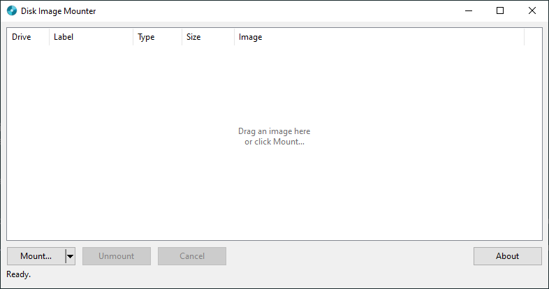

<div align="center">


# dim — Disk Image Mounter

### Double-click an image, get a real DVD drive. No driver. No admin. 340 KB.

[](https://github.com/glauberlima/dim/actions/workflows/ci.yml)
[](https://github.com/glauberlima/dim/releases/latest)
[](#quick-start)
[](#why-dim)
[](LICENSE)

[Quick start](#quick-start) · [Formats](#supported-formats) · [Shortcuts](#shortcuts-and-command-line) · [How it works](#how-it-works) · [Limits](#limits) · [FAQ](#faq) · [Build](#build-from-source) · [AI disclosure](#ai-disclosure)



</div>

**dim** is a tiny Windows 10/11 app that mounts disc images as real optical drives, using the same
virtual-disk API Windows itself uses for ISO files. Drop an image on the window and a new drive letter
appears in Explorer. Close dim, or let it crash, and the drive disappears cleanly. Nothing is installed and
nothing is left behind.

## Why dim

|                         |                                                                                       |
| ----------------------- | ------------------------------------------------------------------------------------- |
| **No driver**           | Mounts through the native `virtdisk` API. No kernel driver, no reboot, no signing prompt. |
| **No admin**            | Runs as a normal user. The manifest is `asInvoker`.                                   |
| **Tiny**                | About 340 KB exe, about 11 MB of RAM, 0% CPU when idle. No runtime, no UI framework.  |
| **Self-cleaning**       | A mount lives only while dim runs. If dim exits or crashes, Windows detaches every drive. |
| **Many formats**        | ISO, CUE/BIN, IMG, RAW, NRG, plus basic MDS/MDF and CCD/IMG. Detected by content, not by extension. |

## Quick start

1. **Download** `dim.exe` from the [latest release](https://github.com/glauberlima/dim/releases/latest).
2. **Run it.** No installer.
3. **Mount an image:** drag it onto the window, press **Ctrl+O**, or click **Mount…**.

Double-click a row to open the new drive in Explorer. Select it and press **Del** to unmount.

> [!TIP]
> Closing the window keeps dim in the tray. Start it hidden with `dim.exe --tray`; a balloon announces
> mounts made while it is hidden. **Quit** from the tray menu asks first, then unmounts everything.

<details>
<summary>Windows warns about the file?</summary>

The exe is not code-signed, so SmartScreen may warn on first run. Click **More info**, then **Run anyway**.
You can compare the file with `checksums.txt` from the release page (`Get-FileHash dim.exe`).

</details>

## Supported formats

| Format                     | Support | How                                                                          |
| -------------------------- | :-----: | ---------------------------------------------------------------------------- |
| **ISO**                    |    ✅    | Mounted directly. CD, DVD and Blu-ray (UDF) images, no conversion.            |
| **CUE / BIN**              |    ✅    | Reads the `.cue`, extracts the first data track.                              |
| **IMG / RAW**              |    ✅    | Any extension. Detected by the CD sync pattern (2352 or 2448 bytes/sector).   |
| **NRG** (Nero)             |    ✅    | Reads the `NER5`/`NERO` footer and the track chunks.                          |
| **MDS / MDF** (Alcohol)    |   Basic  | Metadata is not parsed. The sibling `.mdf` is read as a raw image.            |
| **CCD / IMG** (CloneCD)    |   Basic  | Metadata is not parsed. The sibling `.img` is read as a raw image.            |

> [!NOTE]
> Everything except ISO is first extracted to `%TEMP%\dim\*.iso`, so you need free space equal to the image
> size. The temp file is deleted on unmount, and leftovers from a crash are removed at the next start.

## Shortcuts and command line

| Action                    | How                                                             |
| ------------------------- | --------------------------------------------------------------- |
| Mount an image            | Drag and drop, **Ctrl+O**, or **Mount…**                        |
| Open the drive            | Double-click a row or press **Enter**                           |
| Unmount                   | **Del** or **Unmount**                                          |
| Recent images             | The arrow on **Mount…** (last 10, also in the tray menu)        |
| More actions              | Right-click a row: open, show in Explorer, copy path            |
| Mount from a terminal     | `dim.exe "D:\games\disc.cue" "D:\tools\setup.iso"`              |
| Start hidden              | `dim.exe --tray`                                                |

Launching dim again hands your paths to the running instance and exits, so there is only ever one window.
The window remembers its position and size.

## How it works

```text
 .iso ─────────────────────────────────────────────┐
                                                   ▼
 .cue .bin .img .nrg ─▶ prepare() ─▶ extract() ─▶ temp .iso ─▶ AttachVirtualDisk ─▶ E:\
 .mds .ccd .raw          (sniff)    (1 MiB stream,                (read-only, no       real optical
                                     cancellable)                  PERMANENT_LIFETIME)  drive in Explorer
```

- The drive exists only while dim holds the virtual-disk handle. Closing the handle detaches it.
- The drive letter is assigned asynchronously by Windows; dim keeps polling until it shows up.
- Ejecting from Explorer is detected, and the entry is removed from the list.

The full design notes live in [AGENTS.md](AGENTS.md).

## Limits

- Audio tracks are not emulated. Mode 2 Form 2 data (VCD/PS1 streams) comes out wrong.
- MDS/MDF and CCD/IMG work only for a single simple data track starting at LBA 0.
- Compressed formats (CSO, CHD, ISZ, DAA, ECM) are unsupported.
- "Sparse" ISOs (common from torrents) cannot be mounted by Windows; dim shows the `fsutil sparse setflag` fix.
- Windows 10/11 x64 only.

## FAQ

<details>
<summary>Why does it not need administrator rights?</summary>

Attaching a read-only ISO through `virtdisk` works for a standard user. dim never asks for elevation.

</details>

<details>
<summary>Where do my mounts go when I close the window?</summary>

Nowhere: closing the window only hides dim in the tray, and your drives stay mounted. They are detached when
you choose **Quit** or when the process ends.

</details>

<details>
<summary>Why is a drive letter missing right after mounting?</summary>

Windows assigns it a moment after the attach call. dim fills it in as soon as it appears (up to about a minute).

</details>

## Build from source

Needs Rust 1.99 (edition 2024) and the MSVC toolchain.

```sh
cargo build --release   # -> target/release/dim.exe
cargo test
cargo clippy --release --all-targets -- -D warnings
```

Close any running `dim.exe` before rebuilding, because Windows locks the binary.

```text
assets/   icon, manifest, resource script, logo SVG
docs/     images used by this README
src/
├─ main.rs      window, tray, list view, message loop
├─ convert.rs   format detection and extraction to ISO
├─ vdisk.rs     virtdisk attach/detach, drive letter lookup
└─ store.rs     recent list and window placement
```

AI coding agents and contributors: start with [AGENTS.md](AGENTS.md).

## AI disclosure

Generative AI wrote most of this project. The Rust code, tests, documentation and CI workflows were produced
with [Claude Code](https://claude.com/claude-code) (Anthropic). The developer set the goals and design
decisions, carefully reviewed the generated code, tested the app on Windows, and is responsible for the result.
Bugs are possible: please [open an issue](https://github.com/glauberlima/dim/issues).

## License

[MIT](LICENSE) © 2026 [Glauber Lima](https://github.com/glauberlima)
